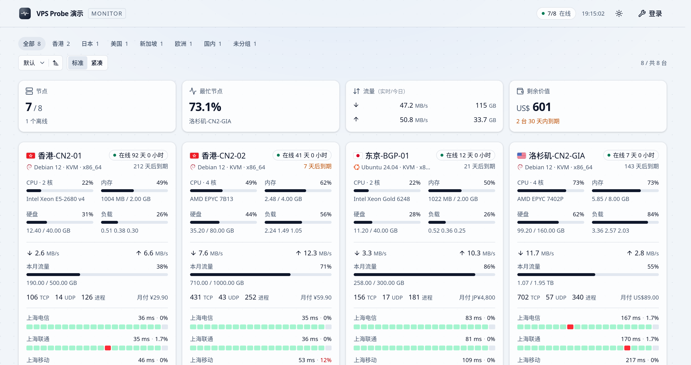

# monitor-web-site

hub 的公开状态页，也是 hub 唯一内置、唯一使用的前端主题。

React + Vite + shadcn/ui。浅深两套配色跟随系统，也能在页面右上角钉住其中一套。



> 预览图是 `npm run dev:mock` 的样例数据（8 台节点），1440px 宽的两倍屏截图。

本目录是 hub 的**构建期输入**：`npm run build` 产出 `dist/`，hub 的 `build.rs` 在编译时把它同步到
`target/theme/dist/` 并用 rust-embed 嵌进二进制。改这里的源码后重新 `make hub` 即生效，不需要打包
发布，也没有任何安装/切换/更新的入口——hub 里不存在主题市场，页面上也没有可以配置的东西。

## 开发

页面只读公开数据。开发服务器直接拿一个现成的 hub 当数据源，要求它开着公开状态页：

```bash
npm ci
# Vite 将 /api 与 WebSocket 代理至这个 hub
MONITOR_HUB=https://hub.example.com npm run dev
```

不设 `MONITOR_HUB` 时代理至 `http://127.0.0.1:9911`。

### 不连 hub 的本地预览

改界面时没必要为看一眼效果去部署一台带真实探测的机器：

```bash
npm run dev:mock          # http://localhost:5173
```

`dev:mock` 是 `vite --mode mock`：该模式下 `vite.config.ts` 挂上 `dev/mockHub.ts` 这个插件并关掉
`/api` 代理。插件自己回答 `/api/me`、`/api/nodes`、`/api/nodes/{id}/metrics`，并在 `/api/ws` 上手写
WebSocket 握手、每 2 秒推一帧——URL 与 JSON 形状都和真 hub 一样，所以 `src/` 里没有一行 demo 分支，
`npm run build` 的产物也不含 `dev/`。

样例是 8 台节点，各演一种情况：3 个探测的正常机、周期拥塞的坏线、只有 2 个探测、有 5 个探测（只画前
3 个）、1 个探测、离线、流量将尽、即将到期。数据在 `dev/demoData.ts`，是对时间戳的纯函数：刷新页面
不会重排历史，轮询时颜色也不会跳动。

`src/lib/demo.contract.ts` 把样例数据与 `Node` 类型绑在一起，页面读到的字段样例若没给，`tsc -b` 直接
报错——样例不会悄悄落后于页面。

## 页面契约

页面是纯静态 SPA，只能依赖下列同源接口：

| 接口 | 用途 |
|---|---|
| `GET /api/me` | 站点名、登录状态、公开页开关、历史保留天数 |
| `GET /api/nodes` | 节点列表、实时指标和累计流量 |
| `GET /api/nodes/{id}/metrics` | 历史指标和延迟记录 |
| `GET /api/ws` | 每 2 秒推送一次节点快照的 WebSocket；带 `?gzip` 时每帧 gzip 后以二进制消息发出 |

`metrics` 的三个查询参数都可省：

- `hours=N` 窗口宽度。**上限是 hub 的保留天数**（`/api/me` 的 `history_days`），登录与匿名相同，超出
  静默 clamp，所以档位要按它生成。7 天以内取分钟明细，更宽取每小时的汇总
- `points=W` 调用方画得下的点数，只会让 hub 抽得更稀，不会更密
- `series=metrics|ping` 只取要画的那一半，省掉的那半原本占响应的三分之一到三分之二

匿名访问 `GET /api/nodes` 仅返回 `public=1` 的节点，响应中不含 `ip`、`hostname`、`remark`。字段定义以 hub 的
`monitor/src/api.rs` 为准。**公开页不渲染地址**，规格表里也没有留给它的格子。

## 延迟色块的口径

节点卡底部和详情页的延迟图读的是 `series=ping`，一个色块是一段时间的读数，不是一次采样。

- **一格三分钟，二十格是一小时。** 三分钟足够短，一段拥塞会落在两三格上成为一条带子，而不是一个像素；
  也足够长，一小时只是二十格。
- **延迟与这条线自己的常态比，不比绝对值。** 常态是窗口内各桶中位数（只算应答的）的中位数，下限 30ms；
  超出 25% / 60% / 120% / 200% 各升一档，再多是最差档。所以 260ms 的回国线路不会整条变红，它只是慢。
- **丢包按绝对值分档**：≤1 / 3 / 6 / 9% 各一档，更高是最差档。一格里延迟与丢包取二者中更差的那一档。
- **整窗丢包率只在响应的 `loss` 里**，按探测 id 给出百分比，没丢包的探测不出现。**不要拿样本行里的
  `loss` 自己平均**：那一个是所在桶的百分比，除数已经丢了，而各桶样本数天然不等——窗口首尾两桶本来
  就是残缺的，探测启停、节点掉线、agent 跳过一轮都会再造几个。十三次里丢一次，平均桶百分比会算出 50%。
- **小卡只有一条带子**：一格里取三条探测中最差的那一档。4px 的高度分不出三条线，问题也不是「哪条线
  不好」而是「这台机器出去的路好不好」，哪条线、差多少，点进去看。
- 探测曲线的名字在响应的 `probes` 里随样本一起下发，匿名可读，所以画延迟图不需要第二个请求，也不需要
  管理员身份。

## 图标与字体

- **线条图标只有 Lucide**，经 `src/components/ui/glyph.tsx` 统一：14 / 16 / 20 三个盒子，没有第四个。
  Lucide 的描边随盒子缩放，12px 时描边落到 1px 就糊了，所以低于 14 的一律不用。
- **系统与发行版标记是 simple-icons 的填充路径**，线条图标集里没有这些东西。
- **国旗是 `country-flag-icons` 的 3x2 SVG**，用 `import.meta.glob` 收进来按 `country`（ISO 3166-1
  alpha-2）取；取不到就不画，不猜。
- **站点图标**是本地的 `public/favicon.svg`、`favicon.ico`、`favicon-16/32/192.png`、
  `apple-touch-icon.png`。运营者在 `/admin/` 传了站点图标时，hub 让 `favicon.svg`、`favicon.ico`、
  `apple-touch-icon.png` 改为返回那张图，并在 HTML 里给引用加上 `?v=<etag>`（浏览器记标签页图标是按
  URL 记的）；那几张定尺寸的 PNG 仍是本地文件，只在浏览器不走 SVG 时兜底。**文件名与路径不能改**，
  hub 侧是写死的。
- 字体只用系统栈，不下载任何字体文件。

## 样式与主题

- 颜色全是 Tailwind 的色阶，写在 `src/index.css` 一处，用 `light-dark()` 配对：`:root` 的
  `color-scheme` 是 `light dark`（跟系统），`.light` / `.dark` 钉死。所以首屏在脚本跑之前就已经是对的那一套。
- `theme` 键存在 `localStorage`，取值 `light|dark|system`，与后台 `/admin/` 共用同一个键和读法。
- 排序键与密度（标准 / 紧凑）也是访客自己的，存在 `localStorage`：`sort=cpu:desc`、`density=standard|compact`。
  进不了 URL（没人会分享「我的节点按 CPU 排」），也不进服务端——hub 没有主题设置接口。
- `prefers-reduced-motion: reduce` 时过渡与动画统一压到 0.01ms；图表的动画本来就在系列上关掉了。

## 测试与构建

```bash
npm run build && npm run lint && npm test
```

`npm test` 跑数字格式化、坐标轴与时间刻度、实时指标的输入边界、十一种排序与地区表，以及一次服务端渲染
冒烟（`Vite ssrLoadModule` + `renderToString`）。没有测试框架，Node 自己剥掉类型，失败时退出码非零。

冒烟测试能覆盖结构与类名，**覆盖不了观感**：颜色、间距、图表曲线仍然要靠 `dev:mock` 里人眼看。

## 路由与反向代理

未知路径回落到本页面的 `dist/index.html`，客户端路由可用。`/admin/*` 由 hub 内置后台接管，不属于本页面的契约。

本页面用 `/node/{id}` 作为详情页。hub 的回落对它够用，但**hub 前面若有按路径做正向白名单的反代
或 WAF，得把这个前缀放行**：从列表点进去只是 pushState，边缘看不见，刷新详情页才会真的请求
`/node/{id}`，症状是「点进去正常，一刷新就被拦」。

图标 `/favicon.svg` 和 `/apple-touch-icon.png` 同样要放行，后者被拦时 iOS 收藏和添加到主屏幕都没有图标。

## 许可

MIT
